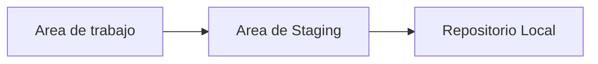
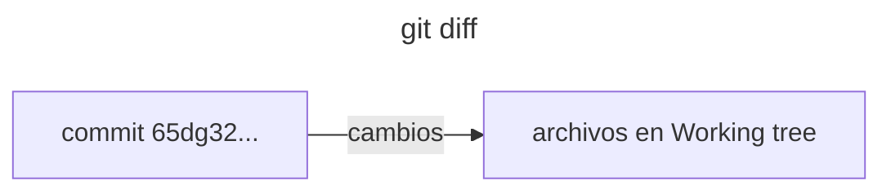
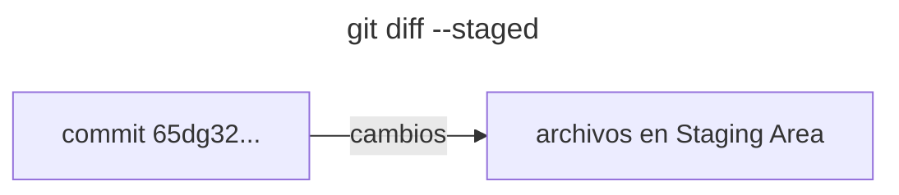
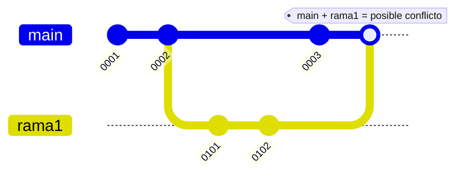
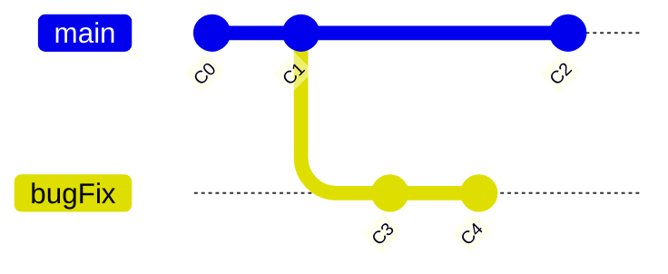
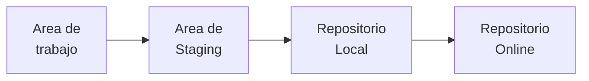

## Indice

- Git
	- [[#Configuración inicial]]
	- [[#Repositorios]]
	- [[#GIT HUB (Repositorios Remotos)]]
	- 

# Git

>[Libro de Git](https://git-scm.com/book/en/v2)
## Configuración inicial
Al iniciar Git, hay opciones que es recomendable configurar de manera global, sistema y si es necesario, local también. Al iniciar un cambio en la configuración, podemos indicar que tipo será, de la siguiente manera

##### limpiar consola git
`clear`
##### git config
`git config --(local/global/system)`
	 `--local`  realiza cambios para ese repositorio en particular (por defecto si no se especifica) Por ejemplo, queremos usar un nombre de usuario distinto para un repositorio específico.
	`--global`  realiza cambios para todos los repos en ese equipo.
	`--system`  realiza cambios para todo el sistema.

##### Ver la lista de configuraciones globales:
Para ver las configuraciones realizadas podemos usar el comando conjuntamente con el flag de tipo de config y `--list`:
Ejemplo:
`git config --global --list`
##### Ver configuración y entorno al cual se aplican
Para ver la lista de configs total y a qué entorno(local, global o sistema) se están aplicando, usamos:
`git config --list --show-origin`
##### Configurar usuario
Para configurar el nombre de usuario que queremos git use en commits y demás registros, usamos:
`git config --global user.name "DavidGiordano"`
#####  Configurar mail
Se puede configurar el mail del usuario actual con:
`git config --global user.email "davidseba.giordano@gmail.com"`

Si queremos usar un nombre de usuario y mail en particular para un proyecto, corremos los mismos comandos, dentro del proyecto, pero sin el flag `--global`.

>Ejemplos
- `git config user.name "usuarioTemporal"`
- `git config user.email "miUsuarioTemporal@yahoo.com"`

##### Configurar el editor por defecto (visual studio code) para mensajes y edición de archivos
Se puede configurar el editor de código por defecto que abre git al momento de tener que corregir un merge o escribir el texto de un commit. En general, lo que se setea aqui es el comando a ejecutar, para abrir el editor, que está definido como variable de entorno en Windows. `code` es el comando que Visual Studio Code deja en la variable de entorno `PATH` , el cual se puede ejecutar desde la consola y esto abre el IDE, por lo que si ejecutamos `code` esto permite abrir una instancia de *VSCode*. Para que por defecto, se utilice en comandos de git, lo debemos configurar de la siguiente manera:
`git config --global core.editor "code --wait"`

El `--wait` genera que se confirmen los cambios cuando se cierre el editor de codigos.

##### default branch - rama por defecto al inicializar repositorio
Por defecto, git creará una rama raíz con el nombre `main` cuando se crea un nuevo repositorio.
Esto se puede configurar:
`$ git config --global init.defaultBranch [nombreDeLaRamaPorDefecto]`

>Ejemplo
`$ git config --global init.defaultBranch principal`

##### Configurar colores de interfaz
Esto configura el uso de colores al presentar información pertinente.
`git config --global color.ui true`
##### Configuración extra, evitar problemas a futuro con el texto (funciona solo en windows)
`git config --global core.autocrlf true (carriage return line feed)`
##### Configuración abreviada del hash de commits, sea de x dígitos (normalmente 10)
Normalmente, el hash que compone cada commit es presentado como una cadena de 10 dígitos. Como estos hash se utilizan bastante al momento de elegir aplicar cambios a un commit específico o aplicar un commit sobre otro, debemos poder escribirlos y referenciarlos.
Para evitar escribir estos 10 dígitos, podemos "acortar" el código que presenta git (*aunque originalmente se utilicen los 10 dígitos para definirlo*) y usar un hash de "menos digitos" que igualmente, referencien al hash que necesitamos. Podemos setearlo determinando qué cantidad de dígitos queremos cambiando la `X`
`git config --global core.abbrev X`
##### Ver qué valor tiene cierta variable
Para poder ver qué valores tiene asignada una variable en particular de la configuración, se puede escribir el comando que se usaría para asignar un valor, sin asignar nada, y git informará qué valor tiene.
Ejemplo, si queremos saber qué valor guarda la variable `defaultBranch` usamos:

 `git config init.defaultBranch` 

---
##### Chequear la configuración general
para verificar los valores ingresados en la configuración podemos usar:
`$ git config --list`

>Esto nos dara algo similar a esto dependiendo de las variables que configuramos
```console
$ git config --list
user.name=John Doe
user.email=johndoe@example.com
color.status=auto
color.branch=auto
color.interactive=auto
color.diff=auto
...
```

También se puede ver el valor de una única variable usando
`$ git config [variable]`

>Ejemplo
>`$ git config user.name`

---
##### Ayuda de la consola.
Para solicitar ayuda sobre qué parámetros puede llevar un comando, podemos escribir en la linea de comandos `git + comando + -h`

>Ejemplo
>`$ git commit -h`

---
### info adicional
[How do i force git to use lf instead of crlf](https://stackoverflow.com/questions/2517190/how-do-i-force-git-to-use-lf-instead-of-crlf-under-windows/13154031#13154031)

---

## comandos básicos del shell
##### Comandos basicos del shell (linea de comandos)
Acceder a una carpeta:
`cd (nombre entrar carpeta)` 

Volver un nivel afuera de donde estamos parados:
`cd ../` 

Crear una carpeta en el directorio actual
`mkdir (nombre de carpeta)`

Borrar una carpeta del directorio actual
`rmdir (nombre de la carpeta)`

Borrar archivo
`rm (nombre del archivo)`

Listar contenido del directorio actual
`dir`

`ls`

`ls -l`

`ls -lh`

Crear archivo nuevo
`touch (nombre de archivo.ext)`

Copiar archivos
`cp (nombre del archivo a copiar) (nombre del directorio donde queremos copiarlo)`

Mover archivos
`mv (directorio del archivo/nombre de archivo.ext) (directorio a donde queremos mover el archivo)`

Elimina carpeta con archivos, todo junto
`rm -r (nombre de la carpeta a eliminar, junto con sus archivos)`

---



---
## Inicializar un repositorio local
Antes de comenzar a guardar versiones de los archivos, se debe inicializar una carpeta como un repositorio mediante el comando:
`$ git init` 

Esto crea una carpeta oculta llamada `.git` que guarda información relevante para el uso y manejo de ese repositorio por git.

### Clonar un repositorio remoto
Si en cambio, queremos descargar un repositorio remoto, usamos el comando 
`$ git clone [protocolo][direccion del repositorio]`

>Ejemplo HTTPS
>`$ git clone https://github.com/Sebastian659835/miRepoRemoto01.git` 

>Ejemplo SSH
>`$ git clone Sebastian659835@github.com:miRepoRemoto01.git` 

### Agregar archivos al area de STAGING
Agregar todos los archivos al area de staging 
 `git add .` 

Agregar un archivo específico al area de staging
 `git add (nombre del archivo uno por uno)`

Agregar archivos por extensión en particular
`git add *.c`
esto agregará al *tracking de archivos*, los archivos de extensión `.c` nada más. 
*(cualquier otro archivo, si existiese, no se agregaría al tracking)*

Ejemplo:
`git add index.html image.jpg readme.txt`

### Eliminar archivos del area de STAGING
Para sacar archivos del area de staging, puedes indicarle a GIT que **NO SIGA TRACKEANDO** el archivo (*untracked en git status*)
`git rm --cached (nombre del archivo)`
esto hace que al hacer `git status`, se muestre el archivo indicado en la parte de "**untracked files**".
indicando que el archivo existe, pero que git no está "tomando cuenta" de los cambios en el mismo.

Este comando en particular, remueve el archivo del area STAGED indicado. Si hemos mandando al STAGING un archivo, lo modificamos, y luego devolvemos con este comando al WORKING DIRECTORY el mismo archivo, la versión que prevalece es la modificada por último.
`git restore --staged (nombre del archivo EN EL area de staging que queremos SACAR)`

### Elimina todos los archivos del area de Staging
Este comando devuelve todos los archivos al área de trabajo.
`git reset` 

### Eliminar modificaciones hechas en archivos sin agregarlos al staging, ni commiteados.
Si tenemos un commit, y luego modificamos alguno de estos archivos trackeados, pero nos damos cuenta que no queremos aplicar estos cambios sobre el commit inicial, podemos hacer uso del comando
`git reset --hard HEAD`
Esto devuelve el estado de los *archivos trackeados* al estado del commit inicial.

SI SE HAN CREADO archivos nuevos, en este proceso de modificaciones de los otros archivos trackeados, estos archivos no sufren cambios dado que no estaban siendo seguidos.

>Si queremos mantener estos nuevos archivos pero descartar el codigo modificado, usamos el comando 

`git reset --hard HEAD`
y luego, sumamos los archivos no trackeados al area de *STAGING*

`git add .`
y luego hacemos commit.


>Si queremos descartar estos archivos nuevos que creamos luego del commit inicial

para que quede el proyecto tal cual lo recibimos luego del commit inicial, podemos usar también, luego de `git reset`
el comando 
`git clean -fd`

Esto descarta los archivos nuevos no trackeados
### git status - Verificar cambios en los archivos trackeados
Al ir modificando, creando y eliminando archivos, nos vamos a encontrar con que el repositorio local va a ir mostrando "cambios". Estos cambios, se pueden verificar con el comando git status
`git status`

**??** =  archivos que no se están "siguiendo".
**A** = archivos nuevos que han sido agregados al area de staging.
**M** = Los archivos modificados tienen una `M` al lado, esto indica que han cambiado desde el estado inicial del *commit actual*.
Los archivos que no han cambiado, no figuran en la lista.
La lista de propiedades (**?, A, M**) se presenta en dos columnas, la primera responde al estado del archivo al agregarlos al area de Staging(luego de hacer `git add .`)
La segunda columna, indica si luego de haber agregado archivos al area de Staging, se hizo otro cambio o se agregó otro archivo a la carpeta en cuestión, etc.

>Ejemplo
```console
$ git status -s
 M README
MM Rakefile
A  lib/git.rb
M  lib/simplegit.rb
?? LICENSE.txt
```
Esto indica que:
- el archivo `README` ha sido modificado LUEGO de agregar los archivos al area de Staging.
- el archivo `Rakefile`, ha sido agregado al area de Staging luego de ser modificado, y ha sido modificado nuevamente luego de ser agregado.(por lo tanto, si queremos incorporar los nuevos cambios, habría que agregarlo de nuevo)
- el archivo `lib/git.rb` es un archivo nuevo del repositorio y ha sido agregado para ser "trackeado" por el mismo.
- el archivo `lib/simplegit.rb` ha sido modificado desde su estado anterior y está agregado al area de Staging.
- el archivo `LICENSE.txt` es un archivo *NO TRACKEADO* por el repositorio.

existe otra forma de verificar los archivos de una manera más corta.
`$ git status --short // git status -s`

---
### Archivo .GITIGNORE 
Podemos definir un archivo que determina qué archivos GIT debe ignorar al momento de trackear o buscar cambios para realizar un commit. 
Esto sólo funciona para archivos que **NUNCA** se han guardado en un commit, si el archivo ya se subió *se seguirá trackeando siempre y cuando no se elimine del tracking* y esté agregado al **.gitignore**

El archivo se puede abrir con el *Visual Studio Code* y se puede comentar dentro con el símbolo
`#`

- **Archivos**
Se puede agrega el archivo a ignorar indicando `[nombre.ext]` 
También se pueden definir por extensión directamente, pero esto ignorará TODOS los archivos de tales extensiones sin importar su nombre:  `.txt / *.jpg / *.py`

Si queremos definir no trackear a todos los archivos de tal extensión, *PERO QUEREMOS EXCEPCIONAR* un archivo dentro del grupo de archivos definidos, podemos negar su nombre luego de haber definido ignorar la extensión
`/.txt`
`!miArchivoDeTexto.txt`
  
- **Directorio Completo**
Para ignorar una carpeta entera, escribimos el nombre de la carpeta en si.
`MiCarpeta1/`

- **CONFIGURAR UN ARCHIVO .GITIGNORE general**:
Para configurar un archivo .gitIgnore general local de nuestra pc, donde pongamos todos los archivos que no queremos que se tracken en ninguno de los proyectos que trabajemos, podemos definir la ruta al unico archivo .gitIgnore asi:
`git config --global core.excludesfile [ruta en la pc del archivo]`
Ejemplo: `git config --global core.excludesfile c:/generalfiles/.gitignore_global`

>**Ejemplo de un archivo .gitignore**
```gitignore
# ignorar todos los archivos de extensión .a
*.a

# ignorar archivos que tengan extension .gif o .tif
*.[gt]if

# pero sí hacer seguimiento del archivo lib.a, incluso si estás ignorando archivos de extensión .a
!lib.a

# only ignore the TODO file in the current directory, not subdir/TODO
/TODO

# ignore all files in any directory named build
build/

# ignore doc/notes.txt, but not doc/server/arch.txt
doc/*.txt

# ignore all .pdf files in the doc/ directory and any of its subdirectories
doc/**/*.pdf
```

---
### git diff - Ver los cambios detallados entre archivos mencionados por gitstatus

##### git diff
Git diff compara los cambios realizados en los archivos en el working tree con los del último commit.
Si existen cambios en area de Staging, y cambios luego de agregar los archivos a Staging, entonces git diff muestra estos últimos cambios, entre *Staging* y *no agregados*


 Supongamos que hicimos cambios a un archivo `README`, y lo agregamos al Staging, y luego de esto, cambiamos otro archivo llamado `CONTRIBUTING.md`.
 El retorno de `git status` sería algo asi:
```console
$ git status
On branch master
Your branch is up-to-date with 'origin/master'.
Changes to be committed:
  (use "git reset HEAD <file>..." to unstage)

    modified:   README

Changes not staged for commit:
  (use "git add <file>..." to update what will be committed)
  (use "git checkout -- <file>..." to discard changes in working directory)

    modified:   CONTRIBUTING.md
```


##### git diff -staged


Para ver qué *cambios* se hicieron, pero no se mandaron al *Staging*, usamos 
`$ git diff` sin argumentos!

>la devolución sería algo similar a esto (dependiendo de los datos cambiados)
```console
$ git diff
diff --git a/CONTRIBUTING.md b/CONTRIBUTING.md
index 8ebb991..643e24f 100644
--- a/CONTRIBUTING.md
+++ b/CONTRIBUTING.md
@@ -65,7 +65,8 @@ branch directly, things can get messy.
 Please include a nice description of your changes when you submit your PR;
 if we have to read the whole diff to figure out why you're contributing
 in the first place, you're less likely to get feedback and have your change
-merged in.
+merged in. Also, split your changes into comprehensive chunks if your patch is
+longer than a dozen lines.

 If you are starting to work on a particular area, feel free to submit a PR
 that highlights your work in progress (and note in the PR title that it's
```

Este comando compara que está en tu actual `directorio de trabajo` con lo que está en tu `Staging`. 
- Si queres ver, la diferencia de lo que hay en el area de Staging, con respecto a tu ultimo commit realizado anteriormente, se usa:
`$ git diff --staged`

---
### Realizar Commit 
El commit es una instantánea del estado de proyecto actual del repositorio git.
Esto toma los archivos con sus cambios que hay en el `area de Staging` (*no agrega lo que está modificado luego de agregar los cambios a Staging*)
Estas instantáneas van a ser nuestros "estados" a los cuales podremos volver, revisar, comparar en otros momentos como "hitos" de nuestro proyecto.

Para realizar un commit, debemos estar *trackeando* archivos del proyecto, y tenemos que haberlos *agregado al area de staging* primero, para indicar qué archivos incluirá el commit. Luego, al tener los archivos que queremos actualizar en el area de staging, podemos usar el comando:

`git commit -m "(mensaje de actualización en el commit)"`  
>El flag `-m` permite escribir el mensaje de commit en la consola

`git commit` 
>al no usar el flag, se abre automáticamente el editor de texto configurado antes, para escribir el mensaje del commit ahi.

##### Realizar Commit --- Sin pasar por el área de STAGING ---
esto evita agregar los archivos al area de staging para hacer el commit.
se pone el flag `-a` y luego el flag de mensaje `-m "mensaje"`

`git commit -a -m "hotfix: login reparado!`
##### Buenas practicas en los mensajes
Las buenas prácticas en los mensajes de Git se pueden iniciar con ciertas palabras claves que nos indican en mayor medida qué fue lo que se hizo.
**feat**: nueva característica
**fix**: se corrige un bug
**tweak**: pequeños cambios en el código.
**copy**: Actualizado boton de inicio.
**refactor**: se refactorizó el código de x función o módulo.

#### Eliminar un archivo del repositorio
Para eliminar el seguimiento de un archivo del repositorio, hay que eliminarlo del area de Staging y luego hacer el commit.
- `$ git rm (archivo)`  :se elimina el archivo.
- luego, se debe agregar la "eliminación del archivo" con `git add (nombre de archivo o punto)` 
- finalmente se realiza el commit.		
`git commit -m "(mensaje)" -a`

Si simplemente borras el archivo de tu directorio. al hacer `git status`, el output indicará que el archivo pertenece a **cambios no ubicados en staging para commit**

Entonces, ahi hay que usar de nuevo el comando para eliminar:
`$ git rm (archivo)`

y eso finalmente deja limpio la salida de `git status`
## Ver historial y hash de los commits

Para ver el listado e historial de commits de la rama actual, podemos usar
`git log`

muestra el log y los hash resumidos configurados de los commits
`git log --oneline`  

muestra los commits de TODAS las ramas
`git log --oneline --all`

##### git log -[cantidad_de_commits_a_presentar]
este comando nos muestra la cantidad de commits que especifiquemos por parámetro, del más actual hacia atrás.

>Ejemplo
>`$ git log -2`
Esto muestra los ultimos 2 commits realizados.

##### git log -p
Esto muestra los commits junto con la diferencia de código ingresado/eliminado entre commits.

>Ejemplo
>`$ git log -p`

##### git log --stat
este comando muestra los commits con un resúmen de cuantas lineas se insertaron/eliminaron en cada commit.
`$ git log --stat`

##### git log --pretty=[modificador]
Esto nos permite formatear como nosotros queramos la salida del `git log`.

>Ejemplo
```console
$ git log --pretty=format:"%h - %an, %ar : %s"
```

Table 1. Useful specifiers for `git log --pretty=format`

| Specifier | Description of Output                             |
| --------- | ------------------------------------------------- |
| `%H`      | Commit hash                                       |
| `%h`      | Abbreviated commit hash                           |
| `%T`      | Tree hash                                         |
| `%t`      | Abbreviated tree hash                             |
| `%P`      | Parent hashes                                     |
| `%p`      | Abbreviated parent hashes                         |
| `%an`     | Author name                                       |
| `%ae`     | Author email                                      |
| `%ad`     | Author date (format respects the `--date=option`) |
| `%ar`     | Author date, relative                             |
| `%cn`     | Committer name                                    |
| `%ce`     | Committer email                                   |
| `%cd`     | Committer date                                    |
| `%cr`     | Committer date, relative                          |
| `%s`      | Subject                                           |

muestra lista de  archivos y carpetas en ese commit
`git ls-tree -r --name-only (hash resumido del commit a ver)`

esto refiere al último commit disponible
`git ls-tree -r --name-only HEAD`

## Deshacer cosas
A veces será necesario corregir subidas, mensajes de commits, faltará agregar archivos, etc.
los comandos para eso serán los siguientes.

##### git commit -amend
Si quieres rehacer el último commit de nuevo, porque faltaron archivos, o quieres reescribir el mensaje del commit, se puede dejar el area de Staging como se necesite(con los archivos que faltaron...) y ejecutar:
`$ git commit --amend`

Esto deja editar el mensaje nuevamente, y agrega y commitea los archivos nuevamente en *staging*.
Esto se hace solamente con archivos locales, dado que si subimos el repo, y luego ejecutamos el amend, y volvemos a subir, puede ser que alguien ya lo haya bajado y se genera una inconsistencia con los archivos. **HACERLO SOLO LOCALMENTE**
##### Sacar del area de Staging
Supongamos que se generaron cambios en archivos y se quiere hacer commit de ellos, en dos cambios separados, pero por accidente se agregan todos con `git add .` y ahora todos los archivos están en *area de Staging*.
En principio, el comando `git status` recuerda con qué otro comando se pueden "sacar" de alrea los archivos requeridos
`...use 'git reset HEAD <file>...' to unstage`

PERO, desde Git versión 2.23.0 se introdujo el comando `git restore` para este tipo de operaciones y evitar usar `git reset`

entonces, si uno de los archivos que queremos sacar del stagin se llamase `archivoJs.js` haríamos:
`git restore --staged archivoJs.js`

y esto dejaría el area de Staging tal cual estaba, con todos los archivos modificados, pero **SIN EL ARCHIVO** `archivoJs.js`

##### Descartar cambios realizados a un archivo en el working tree.
Si nosotros hacemos un commit, y luego seguimos modificando un archivo, y finalmente, nos damos cuenta que no queremos guardar los cambios de ese archivo (pero quizás otros cambios en otros archivos sí) podemos "deshacer esos cambios no commiteados".

**Primero**, si los archivos estan modificados pero no se han agregado al *area de Staging*, podemos hacer uso del comando:
`git checkout -- archivo3.txt`

Si el archivo que queremos descartar los cambios, ya está agregado al *area de Staging*, primero hacemos uso de 
`git restore --staged [archivo]`
y luego sí, usamos
`git checkout -- [archivo]`
Y esto descarta y deja el archivo en el estado que se tomó para el commit precedente.

#### Restaurar un archivo borrado localmente
`git restore (ruta/nombre del archivo.ext)` 
Esto restaura un archivo borrado localmente siempre y cuando no se haya hecho commit luego del archivo ya borrado. Esto restaura el archivo al punto antes del último commit.
Si se hicieron cambios luego del commit y no se guardaron, no van a estar en el archivo restaurado.
#### git revert() - realizar un commit, volviendo al estado del commit anterior

`Git revert` es similar a git reset, pero el enfoque es ligeramente diferente. En lugar de eliminar todos los commit a su paso, la reversión SÓLO deshace un único commit, devolviéndote a los archivos organizados antes del commit.

Así, en lugar de eliminar un commit, git revert invierte los cambios introducidos por el commit original creando un nuevo commit con el contenido inverso subyacente. Esta es una forma segura de revocar un commit porque evita que pierdas tu historial. 

`git revert HEAD`
el código anterior, genera un NUEVO COMMIT, posterior al actual, con los cambios generados en este commit actual desestimados. O sea, elimina los cambios introducidos en el commit actual, pero creando un nuevo commmit "hacia adelante"

`git revert --no-edit <commit ID>`
La opción --no-edit permite al usuario no cambiar el mensaje utilizado para el commit que desea revertir, y esto hará que git revierta el archivo a la rama maestra.

`git revert <commit hash>`
Esto sólo eliminará los cambios asociados a este hash de commit y no afectará a ningún otro commit. incluso funciona si por ej. se han eliminado archivos en un commit anterior, al revertir ese commit, se recuperan los archivos.

`git revert --no-comit <commit ID>  || [git revert -n <commit ID>]`
este comando revertirá los cambios del commit indicado, pero no creará un nuevo commit, para que se puedan verificar y decidir si se commitean asi como están o se agregan más cambios.

---
## git branch (ramas locales)
**T**ener en cuena que depende de en qué rama estemos posicionado, al crear una nueva rama, puede no ser del proyecto principal

- `git branch`  (esto muestra todas las ramas activas y creadas del repo)

- `git branch (nombre de la nueva rama)`  :esto crea una rama(copia del estado actual) con el nombre indicado.

- `git branch -a` : muestra todas las **ramas** tanto locales como en la nube disponibles.

- `git branch -r` : muestra todas las **ramas remotas registradas** (OJO! pueden haber referencias a ramas que ya no existen más remotamente.)

>[!warning] para actualizar esas referencias que quizás están erróneas, se usa 
`git fetch --prune`

---
#### Cambiar la rama activa del código
`git checkout (nombre de la rama en la que se quiere trabajar)` (ya no se suele utilizar)

`git switch (nombre de la rama en la que se quiere trabajar)`

Crear una rama y cambiar a esa inmediatamente:
`git switch -c (nomber de la rama a crear)` 

#### Eliminar ramas 
>ES IMPORTANTE QUE PARA ELIMINAR UNA RAMA, NO DEBEMOS ESTAR PARADOS EN ELLA

>Eliminar rama
- `git branch -d (nombre de la rama a borrar)`

> Cambiar Nombre de Rama
- `git branch -m (nombre actual de la rama) (nombre nuevo de la rama)`

> NO DEBEMOS ESTAR PARADOS SOBRE LA RAMA A MODIFICAR EL NOMBRE


> Cambiar Nombre de la Rama Actual
- `git branch -m (nuevo nombre a colocar en la rama actual)`

> Eliminar una Rama Remota desde Git
- `git push origin --delete [rama_a_borrar]`

#### Fusionar ramas (MERGE).
>IMPORTANTE! para fusionar **RAMA1** con **RAMA2**, debemos estar "parados" en la rama a la cual queremos "mantener". En este caso, debemos estar en **RAMA1** y fusionar **RAMA2** con **RAMA1**, para que los cambios se agreguen a **RAMA1**.

> Fusionar ramas:
`git merge [nombre_de_la_rama_2_a_fusionar]`

==EN CASO DE HABERSE EQUIVOCADO:==
`git reset --hard (HASH del último commit de la rama principal antes de fusionar las ramas)`

ESTO ELIMINA EL COMMIT DE FUSION DE LAS RAMAS pero
no la rama que se fusionó!
EN EL CASO DE QUERER RECUPERAR UN COMMIT BORRADO CON RESET --HARD, si tenemos el HASH de referencia, podemos recuperarlo con
`git reset --hard (HASH del commit borrado)`

#### Conflictos en la fusión. 
Esto suele suceder cuando se trabaja en una rama, desde un punto B de la rama principal, y antes de fusionar la rama con el principal, se da que la rama principal tuvo modificaciones. 



Abriendo el editor de *Visual Studio Code* permite seleccionar qué código va a quedar seleccionado y se realiza el commit desde ahi directamente.
Se pueden aceptar cambios de una rama, de otra, ambas, o seleccionando la opción más conveniente de cada una.

Caso contrario, se pone:
`git merge --continue   (esto finaliza con el commit del merging)`

VER la última actualización de cada rama
`git branch -v`

#### Errores comúnes en la fusión

Cuando querramos fusionar 2 ramas que divergen mucho del código, git intenta advertirnos de esto y nos da un error con el mensaje "NO MERGIN ALLOWED UNRELATED STORIES". Esto indica que no se alcanza cierto porcentaje de similitud al analizar ambos códigos a hacer merge. Para resolver esto, podemos usa el flag `--allow-unrelated-histories`.

`git merge [nombre de la rama a fusionar con la actual] --allow-unrelated-histories`

esto abre el editor para resolver codigo o dejar el mensaje de commit del merging
 
#### DIVERGENCIA ENTRE LAS RAMAS
Puede suceder que si hemos estado trabajando en el proyecto, creado commits locales, cuando querramos integrar con la rama remota, la misma también haya tenido commits desde que le hicimos pull para trabajar en la nuestra, entonces eso se llama **divergencia entre las ramas**. 
Para resolver esto, Podemos directamente hacer un **pull** verificando los conflictos que puedan generarse al integrar las 2 ramas con cambios y luego hacer un **push** con el proyecto mezclado, podemos hacer un rebase.

 ---
## Rebase

La otra manera de combinar "ramas" es utilizar el comando `git rebase`.
Este comando "trae" el historial de la rama pasada como parámetro, y lo aplica en la rama donde estamos ejecutando el comando.

>[!warning] CUIDADO CON ESTO
Rebase no se suele aplicar desde ramas públicas o compartidas (como `main`) porque esto generaría que se genere discrepancia en los commits que se actualizan al ejecutar el comando

Por lo tanto, el rebase se hace generalmente en la rama que creamos, para traer el historial de la "rama pública", aplicarlo como **base** a nuestra rama, y luego usamos desde la rama que traemos la *base* `git merge` para fusionar y dejar limpio el historial.

`(ramaAlternativa) $ git rebase main` y luego
`(main) $ git merge ramaAlternativa`

supongamos que tenemos lo siguiente



y quisieramos mover el trabajo de `bugFix` `C3` y `C4`, dado que divergieron de `main`, justamente a la rama `main`, para que parezca que esas dos tareas se hicieron secuencialmente. Podemos usar entonces el comando `git rebase`

Para esto, tenemos que estar parados en la rama que vamos a **mover**, en nuestro caso, `bugFix`.

1. Desde `bugFix` , hacemos el rebase de `main`
	`$ git rebase main`
2. Esto "mueve" todos los commits de `bugFix` a la rama `main` y descarta la ramificación y dejando solamente el historial de commits de `main` pero con los cambios aplicados de `bugFix`.

##### SHORTCUT
- Si tenemos varias ramas, y queremos hacer un rebase en main, de la rama bugFix, podemos aplicar el comando `git rebase main topic` y esto es un *shortcut* para 
- `git checkout topic`
- `git rebase main`

```
gitGraph
commit id:"0001"
commit id:"0002"
branch rama1
	commit id:"0101"
	commit id:"0102"
checkout main
commit id:"0003"
merge rama1 tag: "main + rama1 = posible conflicto"
```


Luego, para subir los cambios al repositorio en main debemos usar el comando
`$ git push origin main --force-with-lease`

se usa `--force-with-lease` en vez de `--force` a secas para evitar sobreescribir cambios si un colaborador subió algo mientras tanto.

Luego de esto, se puede eliminar la `rama1` local si no se volverá a trabajar en ella.
`$ git branch -d rama1`

Si se creó una rama remota de seguimiento para `rama1`, se puede eliminar también
`git push origin --delete rama1`

---
#### Aliases
Se definen como funciones que guardan todos los comandos determinados para ejecutar más simple

 ej:
  ` git log --oneline --graph --all`
  	
se puede resumir configurando lo siguiente: elijiendo el nombre del comando propio como log simple

`git config --global alias.[nombre del comando propio] "log --oneline --graph --all"`

esto genera que al escribir
`c:> git logsimple` 
esto genere que se dispare el comando configurado anteriormente.

Ver la lista de alias asignado:
`git config --global --list |grep alias`

---

#### GIT REFLOG
  	esto es un log de todos los movimientos generados en el repo, borrados, HASH de elementos borrados, etc.
 

---
  
# GIT HUB (Repositorios Remotos) 




### CREAR Y CONFIGURAR REPOSITORIO REMOTO

#### Autenticarse con ssh
Las claves ssh corresponden a cada pc que vamos a usar, esto nos permite registrar cada equipo y si debemos revocarle el acceso a alguno, no afectamos los demás.

La clave se genera desde windows mismo o desde el bash de git.

Regla importante: generá una clave nueva en cada PC y no copies la clave privada de una computadora a otra. Si alguna PC se pierde o deja de ser confiable, podés revocar solamente su clave.
##### Paso 1. Generar una clave SSH en Windows 11
Abrí Git Bash y ejecutá:
```bash
ssh-keygen -t ed25519 -C "tu-correo@example.com"
```

- los datos de tu-correo@example.com van a ser los que usaste para loguearte en Github.

Te hará algunas preguntas:

1. `Enter file in which to save the key`: presioná Enter para aceptar la ruta predeterminada.
    
2. `Enter passphrase`: escribí una contraseña para proteger la clave privada. Es recomendable; no es la contraseña de GitHub.
    
3. `Enter same passphrase again`: repetí la contraseña.
   
Se crearán dos archivos:

| Archivo                 | Función                                                  |
| ----------------------- | -------------------------------------------------------- |
| `~/.ssh/id_ed25519`     | Clave privada. Nunca la compartas.                       |
| `~/.ssh/id_ed25519.pub` | Clave pública. Esta es la que vas a registrar en GitHub. |

Si ya tenés una clave SSH que querés conservar, no la sobrescribas. Podés comprobarlo antes con:

```bash
ls -la ~/.ssh
```
##### Paso 2. Agregar la clave pública a GitHub
En Git Bash, ejecutá:

```
clip < ~/.ssh/id_ed25519.pub
```

Esto copia la clave pública al portapapeles.

Si por algún motivo, windows no reconoce el comando (o no tenemos el Bash de Git instalado)
Podemos usar el comando para Powershell que nos muestra los datos de la clave en pantalla
```powershell
Get-Content ~/.shh/id_ed25519.pub | Set-Clipboard
```

Esto leería y pegaría el contenido del archivo en tu portapapeles directamente.

Ahora abrí la configuración de claves SSH de GitHub:

1. Hacé clic en New SSH key.
    
2. En `Title`, escribí algo que identifique la PC, por ejemplo `PC Windows 11 - Casa`.
    
3. En `Key type`, seleccioná `Authentication Key`.
    
4. En `Key`, pegá el contenido copiado.
    
5. Hacé clic en Add SSH key y confirmá si te lo solicita.

Repetí este registro con una clave distinta para cada computadora.
##### Paso 3. Probar la conexión SSH
Volvé a Git Bash y ejecutá:

```
ssh -T git@github.com
```

La primera vez puede preguntarte si confiás en la huella del servidor. Verificá que corresponda al servidor oficial de GitHub y, si es correcta, aceptala.

**Si configuraste una *contraseña* para la clave, puede pedirte esa *contraseña*.**

Si todo funciona, verás un mensaje parecido a:

```
Hi TU_USUARIO! You've successfully authenticated, but GitHub does not provide shell access.
```

Eso significa que la autenticación SSH funciona.
##### Paso 4. Comprobar tus repositorios existentes
Ahora tenemos que asegurarnos de que tus repositorios utilicen SSH y no HTTPS.
Entrá a uno de tus repositorios:

```bash
cd /c/gitworks/MiRepositorio
git remote -v
```

Si ves una dirección como esta:
```bash
https://github.com/USUARIO/REPOSITORIO.git
```

ese repositorio sigue usando HTTPS. Para cambiarlo a SSH, ejecutá:

```
git remote set-url origin git@github.com:USUARIO/REPOSITORIO.git
```

Reemplazá `USUARIO` y `REPOSITORIO` por los valores reales de tu repositorio.

Si la dirección ya comienza con `git@github.com:`, no necesitás cambiarla.

Este cambio no elimina tu historial ni tus commits locales.
##### Paso 5. Configurar tu identidad para los commits
La autenticación SSH y la identidad de los commits son cosas diferentes. En cada PC, configurá el nombre y el correo que querés que aparezcan en tus commits:

```
git config --global user.name "Tu Nombre"
git config --global user.email "tu-correo@example.com"
```

Esto no configura el acceso a GitHub; solo define la identidad registrada en los commits nuevos.

---
#### git clone
Abrir el VSC dentro de la carpeta actual.
  `c:> CODE .`     

Este comando trae de un repositorio remoto todos los datos de la rama main.

>Ejemplo
`$git clone git@github.com:usuario/elRepoDelUsuario.git`

Esto copia todo el repositorio mencionado, creando una carpeta de nombre [elRepoDelUsuario] y copiando ahi todos los archivos internos.

>[!important] Importante
>El comando `git clone` ya configura la variable origin para que se referencie al repositorio clonado de la web, para realizar `push`,  `fetch`, etc.

#### git remote -v
Este comando, permite ver las direcciones url que tiene el repositorio configurado para el fetch y el push.
Dependiendo del protocolo de autenticación que usemos mediante Github, puede variar levemente, pero normalmente si hacemos el comando nos resulta en:

```console
$git remote -v 

origin	ssh: git@github.com/usuario/repositorio (fetch)
origin	ssh: git@github.com/usuario/repositorio (push)
```

Si esto no devuelve nada, quiere decir que tenemos el repositorio creado localmente, pero este no está "trackeando" los cambios de ningún repositorio remoto.

Para vincular un repositorio remoto con el nuestro local, podemos usar
#### git remote add
este comando añade explícitamente un repositorio remoto de git del cual descargar y subir commits.

`$ git remote add [nombre_de_referencia] [url]`

notar que normalmente tendríamos solo las lineas de *origin* si es que clonamos el repositorio.
Agregamos otra referencia llamada backdoor, y ahi vinculamos el otro repo remoto.

>Ejemplo
```
$ git remote add backdoor https://github.com/CharlesXavier/mirepo.git

$ git remote -v
origin	https://github.com/schacon/ticgit (fetch)
origin	https://github.com/schacon/ticgit (push)
backdoor	https://github.com/CharlesXavier/mirepo.git (fetch)
backdoor	https://github.com/CharlesXavier/mirepo.git (push)
```

>[!important] IMPORTANTE
>Si creamos un repo local, y luego después de inicializarlo, creamos un repo remoto, deberemos configurar la referencia origin (suele ser ese nombre por defecto) para que el repo local se conecte con el remoto y nos permita hacer *fetch* y *push*

---
#### git fetch
Normalmente, vamos a querer verificar si los repositorios remotos contienen cambios desde que los descargamos, al ser un repo remoto, más de una persona puede estar generando cambios en el código. Para hacer esta verificación, se usa `git fetch`

Este comando sirve para verificar cambios que no tenemos todavia localmente. Si no especificamos el nombre del repositorio remoto como parámetro, la verificación por defecto será de ==origin==. Pero, se puede por ej, otro repositorio remoto, como pb que habiamos definido mucho antes:
`$ git fetch pb`;
después de hacer esto, deberías tener referencia de todas las ramas de ese repo remoto, las cuales se pueden fusionar o inspeccionar primero.

Cuando se clona un repo, automáticamente el comando setea una referencia del repositorio con el nombre `origin`, asi que `git fetch origin` es el comando por defecto para ejecutar cuando tenemos un solo repositorio referenciado.

>[!note] Nota Importante
>`git fetch` baja los cambios del repositorio PERO NO LOS FUSIONA AUTOMATICAMENTE, esto se debe hacer manualmente.

Cuando hacemos un `git fetch`, los cambios que vienen del repositorio remoto se mantienen en una "rama temporal". En general, el mensaje de la consola será:
```console
$ git fetch
remote: Enumerating objects: 4, done.
remote: Counting objects: 100% (4/4), done.
remote: Compressing objects: 100% (3/3), done.
remote: Total 3 (delta 1), reused 0 (delta 0), pack-reused 0 (from 0)
Unpacking objects: 100% (3/3), 1006 bytes | 201.00 KiB/s, done.
From github.com:Sebastian1601/repo-uno-curso-soy-dalto
   4a0615f..50b20e3  main       -> origin/main
```
La última linea, nos indica que los cambios se guardan en la rama temporal `origin/main`.

Para poder "ver" esa rama temporal, y ver qué cambios contienen los archivos que vienen, podemos separar el HEAD (puntero) para apuntar a esa rama, como lo haríamos con cualquier otra, pero con el flag `--detach`

>Ejemplo
>`$ git switch --detach origin/main`

y esto nos dará un mensaje similar al siguiente:
```console
HEAD is now at 50b20e3 Create prueba-de-detach-js
```

Al ser una rama, si usamos el comando `$ git branch` nos figurará la rama temporal entre paréntesis, de la siguiente manera:
```
$ git branch
 (HEAD detached at origin/main)
  main
```

Esto significa que estamos parados en esa "rama temporal con nuestro puntero HEAD".
Ahi podemos revisar el código, verificar qué cambios tiene y finalmente, ver si corresponde hacer el merge con nuestra rama o no.
Si queremos integrar los cambios revisados, volvemos a nuestra rama y realizamos el 
`$ git pull`
Para fusionar los cambios de la rama remota con la nuestra local.

Si en cambio, queremos crear una rama local a partir de esa rama remota que traemos, podemos hacerlo sin hacer el `--detach`
Podemos utilizar entonces la siguiente combinación de comandos:

`$ git fetch` y luego
`$ git switch -c ramaLocal2 --no-track origin/main`

Esto creará una rama local, que no hará track de origin/main, porque ya tu rama main hace track de esa rama remota, sino al hacer pull, se sobreescribiran ambas ramas, y probablemente, si haces una rama de esto, no querrás integrar los cambios en ambas ramas.

Luego puedo verificar si la rama está trackeando alguna rama remota del repositorio, o si nuestro código funcionó con
`$ git branch -vv`

Esto nos listará las ramas locales, y si están trackeando a alguna rama remota, figurará su nombre entre corchetes. Si la rama local no trackea a ninguna remota, entonces figurará solo el mensaje del commit al lado:
```console
$ git branch -vv
main         2b00029 [origin/main: ahead 2, behind 1] "archivo arprueba.txt recuperado!"
* ramaTemporal 50b20e3 Create prueba-de-detach-js
```
#### git pull
Este comando hace lo que `git fetch` no hacía, bajar los cambios del repositorio indicado y ejecutar un `git merge` para fusionar los mismos a nuestra rama en un solo paso.

---
#### Inspeccionando un repo remoto desde la terminal
Si se quiere ver información más detallada sobre un remoto particular, se puede usar el comando:
`$ git remote show <remote>`
Esto nos dará información sobre las direcciones de fetch y push, asi como el nombre de la rama principal, y si las ramas alternativas están siendo trackeadas.

```console
$ git remote show origin
* remote origin
  URL: https://github.com/my-org/complex-project
  Fetch URL: https://github.com/my-org/complex-project
  Push  URL: https://github.com/my-org/complex-project
  HEAD branch: master
  Remote branches:
    master                           tracked
    dev-branch                       tracked
    markdown-strip                   tracked
    issue-43                         new (next fetch will store in remotes/origin)
    issue-45                         new (next fetch will store in remotes/origin)
    refs/remotes/origin/issue-11     stale (use 'git remote prune' to remove)
  Local branches configured for 'git pull':
    dev-branch merges with remote dev-branch
    master     merges with remote master
  Local refs configured for 'git push':
    dev-branch                     pushes to dev-branch                     (up to date)
    markdown-strip                 pushes to markdown-strip                 (up to date)
    master                         pushes to master                         (up to date)
```


#### renombrar referencias de repositorios remotos
Aunque es convención usar `origin` como referencia al repositorio remoto principal de cada repo local, se puede renombrar.
`$ git remote rename [nombre_Actual] [nombre_nuevo]`

>Ejemplo
>`$ git remote rename origin cloudRepo`

#### eliminar referencias a repositorios remotos
Si queremos eliminar referencias a repos remotos, si agregamos más de origin, podemos eliminarlos con el comando:
`$ git remote remove [referencia_al_repo_remoto]`

Una vez que se elimina una referencia remota, todas las configuraciones de las ramas trackeando esa referencia también se eliminan.

---
#### git push

Para poder subir archivos a nuestro repo, debemos tener configurado el mismo mail con el que iniciamos sesión en Github. 
Luego, si queremos subir cambios (nuevos commits) a un repo "clonado", lo hacemos con el comando:
 `git push origin main`
 `git push [nombre del repo remoto] [rama del repo remoto]`

Si esto abre una ventana de log, lo recomendable es hacerlo por [TOKEN]. Para obtener el [TOKEN],
 vamos a Settings > Developer Settings > Personal Acces Tokens > Tokens (classic) y ahi Generar nuevo token

Recomendaciones sobre el token
- No debería ser eterno. Lo recomendable es de 7 a 30 días.
- Los permisos con la primera opción, REPO ya es suficiente.

 Esto generará un código que se debe copiar en el sistema de inicio de sesión de Github por la solapa TOKEN.
 
* Para subir todas las ramas de tu repo local al remoto
`git push --all`

* Para subir al repo remoto _OnlineRepo_ con una rama remota _ramaR_ (distinto nombre de la rama remota a la rama local) tu rama local _ramaL_:

`git push OnlineRepo ramaL:ramaR`

>Ejemplo
`$ git push origin hotFix2:hotFixNode`

#### git pull de rama remota a rama local

Para poder hacer un pull de una rama remota la cual no existe en nuestro repositorio local, debemos crear una **rama nueva** en el **repo local**, y podemos hacer el **git pull** automáticamente creando y descargando la misma con el comando:
`git switch -c [rama_local] [origin]/[rama_remota_a_hacer_track]`

esto crearía en nuestro repo local, una "rama_local", y se descargaría la rama remota desde origin/"rama_remota_a_hacer_track"

#### Configurar un repo remoto limpio luego de tener un repo local con commits
- Primer, ya teniendo los commits en el repo local, creamos el repo remoto, y en git usamos
`git remote add origin [direccion http del repo remoto]`

luego hacemos un fetch de lo que tiene el repo remoto.
`git fetch`

- esto crea una descarga en una rama temporal llamada ***fetch_HEAD***, entonces podemos mergear esa rama temporal con el main nuestro:
parados en nuestra rama local a fusionar, usamos

  `git merge fetch_HEAD --allow-unrelated-histories` dado que no hay una relacion entre los commits.

y esto nos abre el editor de mensajes de commits, para poner un mensaje. al finalizar, tendremos las ramas vinculadas.

finalmente, hacemos un git push

`git push --set-upstream origin main` o el shorthand
`$ git push -u origin main`

Si creamos una rama nueva local, y queremos subir esta al repo remoto, usamos el comando anterior pero con una pequeña diferencia
`git push -u origin [nombreRama]`

#### ERRORES con git push

   There are two ways of solving the fatal: refusing to merge unrelated histories error

   `git pull origin main --allow-unrelated-histories`

 * You can substitute origin with the remote repository you are pulling from. You can also replace the master branch with whatever branch you want the pull request to merge into.

### Option 2: unstage, stash, clone, unstash, and then commit

The alternative (and longer) way of fixing the fatal: refusing to merge unrelated histories issues is to unstage your current commits, stash them, clone your required remote repository, and then place your stashed branch contents into the new clone.

This will ensure that any conflicts that you may encounter in the code are addressed before merging and prevent application errors from occurring.
To unstage all the files in your last commit, use the following git command: git reset HEAD~.

To stash your unsaved files, use the following git command: git stash.

This will give you a clean working tree to pull your remote repository into. Once you’ve successfully pulled into your branch, you can unstash your files, commit them as a separate commit and resolve any file conflicts that you may have.

To unstash your files, use git pop. This will move the changes stashed and reapplies them to your current working copy.

Alternatively, you can use git stash apply to add the changes to your current working copy of code.

Here is a quick summary of differences between git stash apply and <code”>git pop:

  `git pop`: ‘pops’ the changes from the stash and applies them to the current code
  `git stash apply`: keeps the changes in the stash and applies the changes to the current code

The easiest way to prevent the fatal: refusing to merge unrelated histories error is to avoid pulling remote repositories into branches that already have commits on them.

However, sometimes you just want to keep the commits. One way to prevent the error is to create a brand new branch, pull your required code in, and then manually merge your local branch into your main flow.


## GIT STASH (guardar temporalmente los cambios realizados en el area de trabajo sin commitear)

`git stash save "(MENSAJE PARA EL STASH-como un commit)"` 

* Esto guarda los cambios y revierte el directorio de trabajo a como se veía en tu último commit. Los cambios guardados están disponibles en cualquier rama de ese repositorio.

### Ver los cambios guardados en el stash:

 `git stash list`

* Esto devuelve una lista de tus capturas guardadas en el formato stash@{0}: RAMA-STASHED-CAMBIOS-SON-PARA: MESSAGE. La parte de stash@{0} es el nombre del stash, y el número en las llaves ({ }) es el índice (index) del stash. Si tienes múltiples conjuntos de cambios guardados en stash, cada uno tendrá un índice diferente.

* Si olvidaste los cambios que hiciste en el stash, puedes ver un resumen de ellos con el comando 

`git stash show NOMBRE-DEL-STASH`

* Si quieres ver las direferencias de los cambios en la consola, se puede ejecutar lo siguiente:

 `git stash show -p NOMBRE-DEL-STASH`

* Para recuperar los cambios del stash y aplicarlos a la rama actual en la que estás, tienes dos opciones:
  - aplica los cambios y deja una copia en el stash:
    	
   `git stash apply NOMBRE-DEL-STASH` 


  - aplica los cambio y elimina los archivos del stash:

    `git stash pop NOMBRE-DEL-STASH`

 - Si quieres remover los cambios guardados en stash sin aplicarlos, ejecuta el comando:

	`git stash drop NOMBRE-DEL-STASH`

  - Para limpiar todo del stash, ejecuta el comando:

 `git stash clear`


## GIT FETCH 

esto descarga las actualizaciones y nuevos commits que se hayan realizado desde la última vez que se verifico en la rama donde se está aplicando e identifica si existen nuevos cambios o no en dicha rama **PERO NO LAS SINCRONIZA** sino que crea una rama temporal, del mismo nombre para poder	verificar los cambios, *y en todo caso*, sumarlos a nuestro repo local. Luego de ejecutar el *fetch*, debemos "pasar" a la rama temporal que se suele llamar (origin/main) para verificar los cambios hechos, mediante el siguiente comando:

   `git switch --detach origin/main (esto genera que se trate como temporal) `
   
 y luego, si sirven, guardarlos. VOLVER a la rama principal de nuestro repo local para hacer un -git pull-

### Git fetch, revisar cambios y luego merge con la rama main.

`git fetch`
- esto descarga los cambios al repo local, pero figura en la rama temporal.
- Para revisar esa rama local, se usa
  `git checkout fetch_HEAD`
- esto mostrará la rama "temporal" con los cambios nuevos, sin aplicarlos a la rama local main.
 
- SI QUEREMOS guardar los datos, en otra rama, para fusionar o revisarlos, realizamos

`git switch -c [nombre de la rama para mantener el fetch_HEAD]`

- Si ahora usamos `git branch` podemos ver ambas ramas, y hacer un merge, o seguir trabajando en una u otra.
## Migrar repositorio local a uno remoto

Luego de crear un repositorio en Github, mediante Git hay que hacer

`git remote add [nombre de referencia del repo remoto] [dirección http del repositorio remoto creado]`

ej:
   
`git remote add origin https://github.com/Sebastian1601/Codoacodo-tp-nodejs.git`

luego se comanda
`git branch -M main`

y finalmente

`git push -u origin main`

## OTRA MANERA DE MIGRAR UN REPO LOCAL A UNO REMOTO

Teniendo archivos ya en el repo local, creamos una nueva rama a partir de la main y vamos a tener en dos ramas locales, el mismo estado del proyecto.

Luego, te pasas a la rama main local, y de ahi se setea como track la rama main remota creada de cero, con
```bash
git remote add origin (dirección del repo remoto)
```

y luego, haces un *fetch* para confirmar el track y verificar los cambios de la rama main remota, que nos arrojará datos.

```bash
git fetch
```

finalmente, se hace un reseteo de la rama main local, para traer los datos de la rama remota (que normalmente son el archivo Readme y .gitignore)
```bash
git reset --hard origin/main
```

Esto deja la rama local main, sincronizada con la rama remota.
A partir de ahi, se hace un merge de la rama main con la rama copia que habiamos hecho antes de arrancar, forzando que los archivos sean distintos con *--allow-unrelated-histories* y finalmente se hace un push para actualizar la rama remota main.
```bash
// en main
git merge (ramaAlternativaACoopiarEnMain) --allow-unrelated-histories
```

```bash
git push -u origin main
```
Ahi ambos repos están sincronizados.


## RAMAS REMOTAS

* Para ver las ramas remotas que tiene trackeadas el repo local, se ejecuta
  `git branch -a`

* Para eliminar una rama remota listada
  `git push origin -d [nombre de la rama remota a borrar]`

* En caso de que al revisar las ramas remotas de un repo local, con git branch -a, figure alguna y al querer borrarla, indique que no existe la referencia en el repo remoto, se actualiza la lista con 
  `git fetch --prune`
  esto elimina las referencias que no existan en el remoto localmente.
  
 
### FORK

Un fork es una copia de un repositorio remoto en nuestro repositorio remoto. Cuando queremos duplicar algun proyecto del que podemos copiarnos.
Al hacerlo, queda en nuestro repo, y se hace el commit para "guardarlo" por primera vez.


### PULL REQUEST

esto se da cuando hacemos un fork, y guardamos un repositorio que no es nuestro en el repo online.
queremos subirla de nuevo al repo remoto copia del proyecto de alguien más.

cuando ya tenemos cargado en el repo online nuestro el repo local del fork, tenemos una opción llamada [CONTRIBUTE], y de ahi se abre la opción [OPEN PULL REQUEST].
Ahi se verifica que se pueda fusionar ambos repos, y luego se agregan los datos sobre titulo y descripción del pull request.


>[!warning] ERROR AL USAR GIT LOG (queda la lista de commits y luego dice log file: y no sale de esa pantalla.)

Al registrar este error, hay que presionar ESC, y luego la tecla "Q"


## Traer repos remotos a locales cuando una clonación desde GitHub no trae los repos automaticamente.

Esto puede pasar si es que la rama **main** del repo que estamos clonando no contiene nada, y tampoco figuran commits en ella, pero SI posee ramas donde hay commits realizados.

Primero, vemos que si clonamos un repo remoto y figura vacío localmente, vemos si figura con algún commit inicial con lo siguiente

```bash
git log --oneline -5
```

esto nos devolverá una pantalla de resultados de commits si es que la rama y el repo tienen alguna. Sino, devolverá una sola linea.

```bash
875f755 (HEAD -> main, origin/main, origin/HEAD) Initial commit
```

Esto quiere decir que existe solamente el commit inicial de cuando se creo el repositorio. -nada más.

Si vemos esto, podemos chequear si el repo remoto tiene ramas donde estén trabajando en vez de la main, y eso lo vemos con 

```bash
 git remote -v
```

ese comando nos mostrará todas las ramas locales y remotas que existan en el repo.

```bash
  main*
  remotes/origin/CreacionClienteFuncionandoOK
  remotes/origin/HEAD -> origin/main
  remotes/origin/Unificacion-de-proyecto
  remotes/origin/main
  remotes/origin/master
  remotes/origin/unificacion-de-proyecto
  remotes/origin/unificacionConBaseFuncional
```

Esto indica que existen varias ramas remotas y probablemente, como la main está vacía, se esté trabajando en las otras el proyecto o implementaciones completo.

Para traer una *rama remota* en particular , a la rama *main* o cualquier otra rama en cuestión, debemos ejecutar lo siguiente, estando parados en la rama local en la que vamos a traer toda la info...

```bash
//estando para en main...
git switch main
git reset --hard origin/[rama a copiar en la rama en la que estamos parados]
```

esto implica que vamos a hacer un reset hard en la rama en la que estamos parados, en este caso "*main*" con todo el contenido de la rama remota origin/[rama].


>[!danger] IMPORTANTE
>Esto no implica que lo que se cambie en la rama remota ***origin/ramaCopiada*** se va a trackear en la rama main local nuestra!

### Setear que una rama local trackee(detecte actualizaciones) una rama de nombre distinto remotamente

***Tenemos 2 casos***

- Si queremos que una rama local ya creada y con commits por ejemplo, trackee una rama remota que no comparte el mismo nombre remotamente, se puede realizar con el siguiente código, aunque NO ES RECOMENDABLE...

```bash
git branch --set-upstream-to = origin/ramaAtrackear ramaLocal
```

Luego, si haces un *git status* debería mostrar algo así como

```vbnet
Your branch is up to date with "origin/ramaATrackear"
```

- Si no tenemos la rama creada, y queremos crearla y al mismo tiempo explicitar a qué rama remota seguirá, entonces hacemos

```bash
git checkout -b main origin/ramaATrackear
```

Esto creará una rama de nombre "*main*" que automaticamente trackeará a la rama remota "*ramaATrackear*"

>[!important] IMPORTANTE
>esto rompe con la convención estandar:
>La rama local **main** ya no representará **origin/main**, sino otra en **origin/ramaAlternativa**
>Por eso conviene hacerlo sólo si sabés bien lo que querés lograr, o si estás intergrando contenido desde otra rama remota de manera controlada.


##### Alternativa más segura

Este modo implica traer los datos remotos de cierta ***ramaAlternativa*** y fusionarlos con la rama en cuestión local que quieras, pero sin cambiar el tracking de la rama local a la remota.

estando parados en una rama local main por ej...
```bash
git switch main

git fetch origin ramaAlternativa
git merge origin/ramaAlternativa
```


## Chequear a qué rama remota estamos siguiente con la rama local activa

Para verificar qué rama remota estamos trackeando (en el caso de que no se correspondan los nombres, por esto no conviene lo mencionado en el punto anterior) podemos hacer, parados en la rama local en cuestión, el siguiente código

```bash
git branch -vv
```

Esto nos devolverá, si estamos siguiente a una rama en particular, lo siguiente

```bash
* main a75bc2d [origin/main: ahead 23, behind 1] Add files via upload
```

esto significa que nuestra rama *main*, marcada con el símbolo asterisco, está trackeando a la rama en el remoto llamada *origin*, de nombre *main* también (en este caso, esto puede variar.) y que la misma está adelante de la rama remota main por 23 commits, y detrás por 1.

